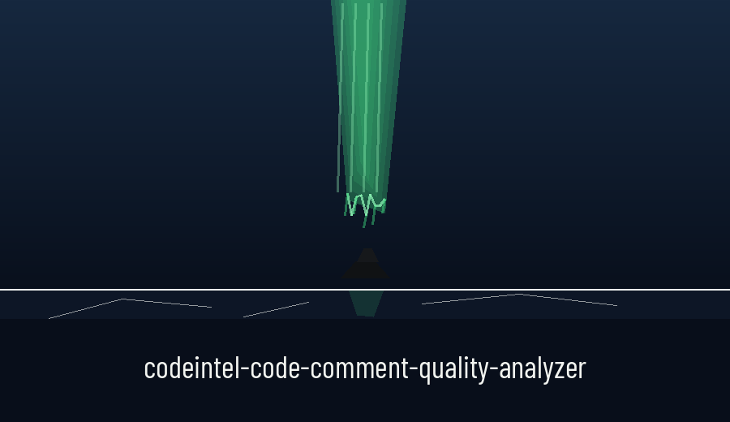
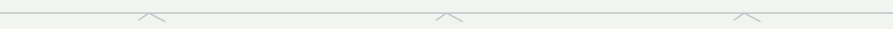
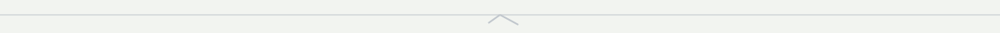

# codeintel-Code-Comment-Quality-Analyzer

Evaluates the quality and completeness of code comments. Checks for missing comments on functions, classes, and complex logic blocks, and enforces comment style consistency when a style guide is supplied. The outdated comment detection is a demonstration keyed to one example pattern (a line matching result = val + 5, with a nearby comment mentioning a word from that line); it does not read code changes, diffs, or version control history, and it does not detect outdated or misleading comments in general. Uses AST analysis and pattern matching.

> **Log marginalia: a demonstration, not a general detector.** The opening above bounds its own widest claim with care: the outdated comment detection is a demonstration keyed to one example pattern, a line matching result = val + 5 with a nearby comment mentioning a word from that line; it does not read code changes, diffs, or version control history, and it does not detect outdated or misleading comments in general. That limit is part of the preserved text above and is flagged here at full size as a credit to the file.

## Install
`git clone https://github.com/ShadowStrikeHQ/codeintel-code-comment-quality-analyzer`

> **Log marginalia: the address names another organisation.** The install line above points to ShadowStrikeHQ, not to ShadowGuard-AI. It is preserved as printed and flagged here, not quietly corrected.

## Usage
`./codeintel-code-comment-quality-analyzer [params]`

> **Log marginalia: what the README never names.** The usage line above is a placeholder, and the parameter list below names no positional argument at all, so the file never says what file or directory the analyser is to be run on. That missing target is flagged here rather than filled in by invention.

## Parameters
- `-h`: Show help message and exit
- `--style-guide`: Path to a JSON file containing comment style guide rules.
- `--verbose`: Enable verbose logging.

## License
Copyright (c) ShadowStrikeHQ

> **Log marginalia: the address names another organisation.** The closing line above reads Copyright (c) ShadowStrikeHQ, preserved as printed and flagged here. The README names no licence in that line.
